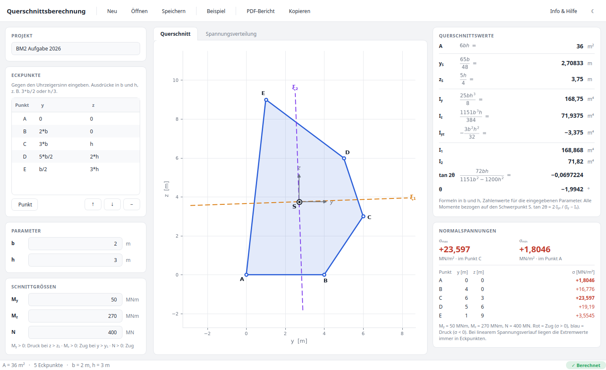
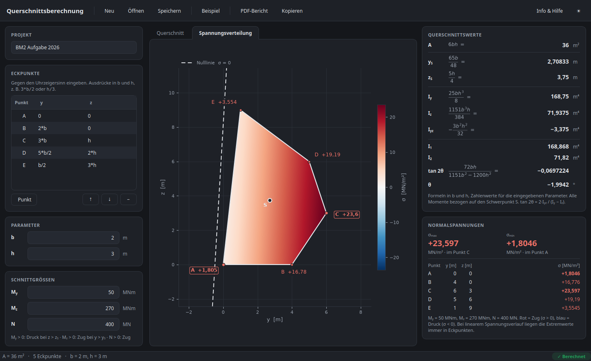

# Querschnittsberechnung

[](https://github.com/LtheHuman/querschnittsberechnung/releases/latest)
[](https://github.com/LtheHuman/querschnittsberechnung/actions/workflows/tests.yml)
[](LICENSE)


Desktop-App zur **symbolischen und numerischen Berechnung von Querschnittswerten**
beliebiger Polygone samt **Normalspannungen bei schiefer Biegung mit Normalkraft**
– entstanden als Hilfe für *Baumechanik 2* an der TU Graz, frei nutzbar für alle.

> **Hinweis:** Privates Studierendenprojekt, **kein offizielles Angebot der TU Graz**.
> Gedacht zur Kontrolle eigener Rechnungen – alle Ergebnisse ohne Gewähr.



## Funktionen

- **Eckpunkte als Ausdrücke** in `b` und `h` (z. B. `3*b/2`, `h/3`, auch `1,5*b`)
- **Live-Berechnung** während der Eingabe – kein „Berechnen“-Knopf nötig
- Querschnittswerte **als Formel und Zahl**: A, y<sub>S</sub>, z<sub>S</sub>,
  I<sub>y</sub>, I<sub>z</sub>, I<sub>yz</sub>, I<sub>1</sub>, I<sub>2</sub>, tan 2θ, θ
- **Diagramm** des Querschnitts mit Schwerpunkt und Hauptachsen ξ₁ / ξ₂
- **Spannungsverteilung** als Farbkarte mit Nulllinie und Werten an allen Eckpunkten,
  σ<sub>max</sub> / σ<sub>min</sub> hervorgehoben
- **PDF-Bericht** (Eingabe, Formeln, Ergebnisse, Diagramme) und Ergebnisse als Text kopieren
- Prüft die Eingabe: Fehler werden direkt am Feld markiert, Selbstüberschneidungen erkannt,
  Eingabe im Uhrzeigersinn wird automatisch umgedreht
- **Hell- und Dunkelmodus** (folgt dem System, umschaltbar)
- Speichern/Laden als JSON (kompatibel mit Dateien der alten Version)



## Download

Fertige Programme – **ohne Python-Installation** – gibt es unter
[**Releases**](https://github.com/LtheHuman/querschnittsberechnung/releases/latest):

| System | Datei | Starten |
|---|---|---|
| **Windows** 10/11 | `Querschnittsberechnung-Windows.zip` | ZIP entpacken (Rechtsklick → *Alle extrahieren*), dann `Querschnittsberechnung.exe` im entpackten Ordner doppelklicken |
| **macOS** (Apple Silicon, M1 und neuer) | `Querschnittsberechnung-macOS.zip` | Entpacken, `Querschnittsberechnung.app` in *Programme* ziehen und öffnen |
| **Linux** (x86-64) | `Querschnittsberechnung-Linux.tar.gz` | Entpacken, `Querschnittsberechnung/Querschnittsberechnung` starten |

**Erster Start:** Das Programm ist nicht kostenpflichtig signiert, deshalb warnt das
Betriebssystem beim ersten Öffnen einmalig:

- **Windows** („Der Computer wurde durch Windows geschützt“): *Weitere Informationen* →
  *Trotzdem ausführen*.
- **macOS** („kann nicht geöffnet werden“): *Systemeinstellungen → Datenschutz & Sicherheit*
  → ganz unten bei Querschnittsberechnung *Dennoch öffnen*.

Der Quellcode ist offen – wer der Datei nicht traut, kann die App auch selbst aus dem
Quellcode starten (siehe unten). Ältere Intel-Macs: bitte die Python-Variante verwenden.

## Installation mit Python (für Entwickler:innen)

Voraussetzung: Python 3.10 oder neuer.

```bash
git clone https://github.com/LtheHuman/querschnittsberechnung.git
cd querschnittsberechnung
python3 -m venv .venv
source .venv/bin/activate          # Windows: .venv\Scripts\activate
pip install -e .
```

## Starten

```bash
querschnitt                        # oder: python -m querschnitt
querschnitt examples/l_profil.json # Datei direkt öffnen
```

## Bedienung

1. **Eckpunkte** gegen den Uhrzeigersinn eintragen (Ausdrücke mit `b` und `h`).
   Mit den Pfeiltasten unter der Tabelle lassen sich Punkte umsortieren.
2. **Parameter** b und h in Metern eingeben.
3. **Schnittgrößen** M<sub>y</sub>, M<sub>z</sub> [MNm] und N [MN] eintragen.
4. Die Ergebnisse aktualisieren sich sofort. Über **PDF-Bericht** lässt sich alles exportieren.

| Tastenkürzel | Aktion |
|---|---|
| `Ctrl+N` / `Ctrl+O` / `Ctrl+S` | Neu / Öffnen / Speichern |
| `Ctrl+Shift+S` | Speichern unter |
| `Ctrl+P` | PDF-Bericht |
| `Ctrl+Shift+C` | Ergebnisse kopieren |
| `Ctrl+Enter` | Neu berechnen |

| `F1` | Info & Hilfe |

Rechtsklick auf ein Diagramm speichert es als PNG, SVG oder PDF.

**Einheiten:** Die Rechnung ist einheitenfrei, beschriftet ist mit m und MN
(σ in MN/m² = N/mm²). Wer konsequent z. B. cm und kN verwendet, erhält σ in kN/cm².

## Konventionen

Koordinaten: y nach rechts, z nach oben; alle Momente beziehen sich auf den Schwerpunkt S.
Bitte prüfen, ob das zu deiner Lehrveranstaltung passt – manche Lehrbücher legen z nach
unten oder definieren I<sub>yz</sub> mit anderem Vorzeichen.

- I<sub>yz</sub> = +∫ y·z dA
- **M<sub>y</sub> > 0** → Druck auf der Seite z > z<sub>S</sub> (M<sub>y</sub> = −∫ z·σ dA)
- **M<sub>z</sub> > 0** → Zug auf der Seite y > y<sub>S</sub> (M<sub>z</sub> = +∫ y·σ dA)
- tan 2θ = 2·I<sub>yz</sub> / (I<sub>y</sub> − I<sub>z</sub>)

Spannungsformel mit D = I<sub>y</sub>·I<sub>z</sub> − I<sub>yz</sub>², ỹ = y − y<sub>S</sub>, z̃ = z − z<sub>S</sub>:

```
σ = N/A + (Mz·Iy + My·Iyz)/D · ỹ − (My·Iz + Mz·Iyz)/D · z̃
```

Da σ im Querschnitt linear verläuft, liegen σ<sub>max</sub> und σ<sub>min</sub> immer in Eckpunkten.

## Projektstruktur

```
querschnitt/
├── core.py          Rechenkern (SymPy, ohne GUI) – auch für Skripte/Notebooks nutzbar
├── plotting.py      Diagramme (matplotlib)
├── report.py        PDF- und Textbericht
├── project.py       Datenmodell, JSON
└── ui/              Qt-Oberfläche (Hauptfenster, Widgets, Theme)
tests/               Tests gegen bekannte Lösungen + GUI-Smoke-Test
examples/            Beispiel-Querschnitte
packaging/           PyInstaller-Konfiguration für die fertigen Programme
```

Rechenkern direkt verwenden:

```python
from querschnitt.core import compute_section, compute_stress, parse_expr

pts = [(parse_expr(y), parse_expr(z)) for y, z in
       [("0", "0"), ("b", "0"), ("b", "h"), ("0", "h")]]
res = compute_section(pts)            # symbolisch: res.I_y == b*h**3/12
num = res.numeric(b=0.3, h=0.5)       # Zahlenwerte
print(compute_stress(num, M_y=0.1, M_z=0, N=0).sigma_max)
```

## Tests

```bash
pip install -e ".[dev]"
pytest
```

## Fehler melden & mitmachen

Fehler gefunden, falsches Ergebnis oder eine Idee? Bitte ein
[Issue anlegen](https://github.com/LtheHuman/querschnittsberechnung/issues/new/choose).
Pull Requests sind willkommen – vorher bitte `pytest` laufen lassen.

## Neue Version veröffentlichen

Version in `querschnitt/__init__.py` erhöhen, committen, dann einen Tag pushen:

```bash
git tag v2.0.1
git push origin v2.0.1
```

GitHub baut daraufhin automatisch die Programme für Windows, macOS und Linux, testet sie
und veröffentlicht sie als Release.

## Lizenz

[MIT](LICENSE) © 2026 LtheHuman – frei nutzbar, veränderbar und weitergebbar, solange der
Lizenz- und Copyright-Hinweis erhalten bleibt. Ohne Gewähr.

Die fertigen Programme enthalten Qt for Python (PySide6, LGPL-3.0) sowie SymPy, NumPy und
matplotlib (BSD-artige Lizenzen).
